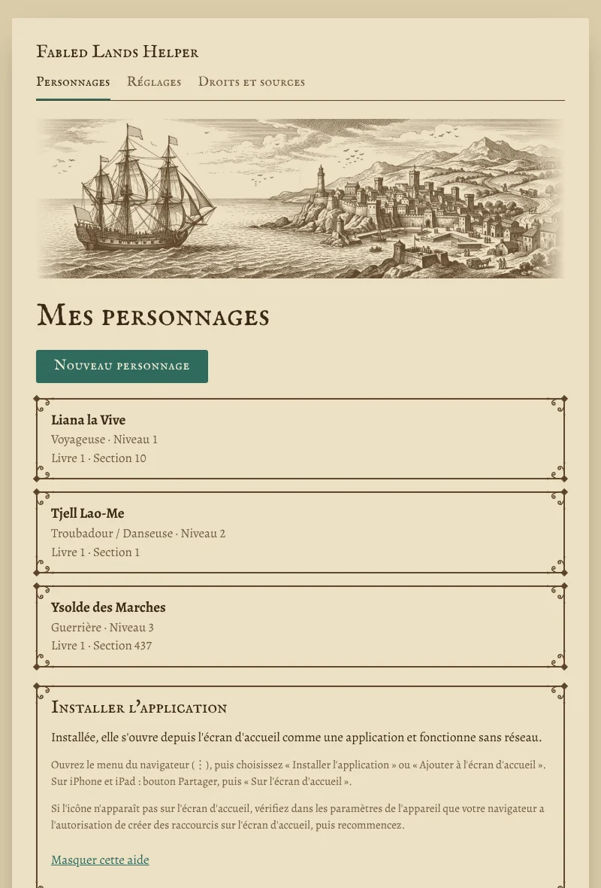
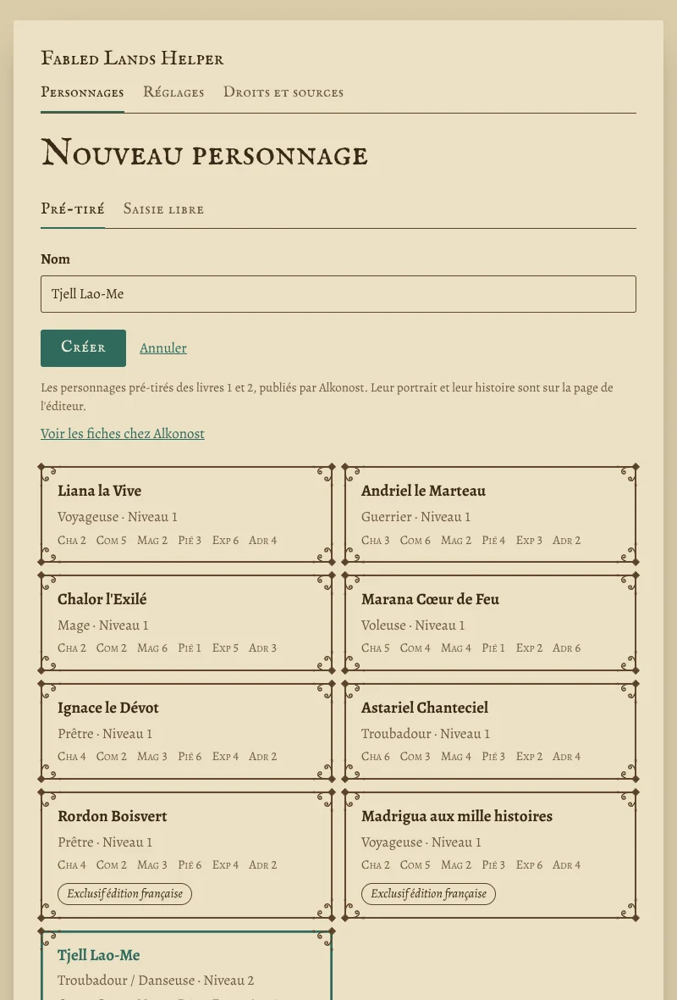
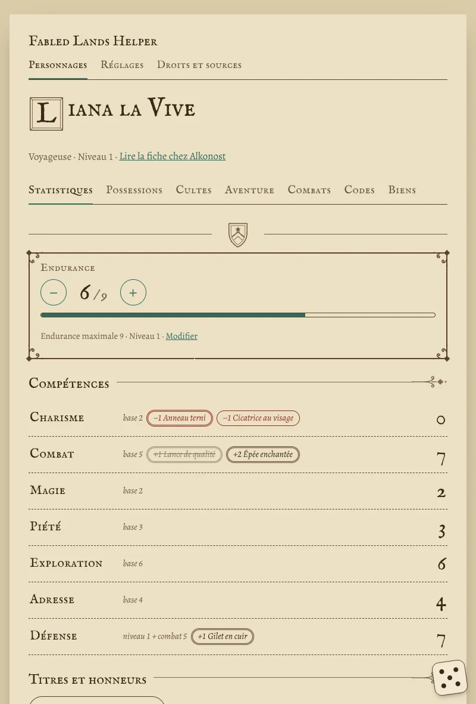
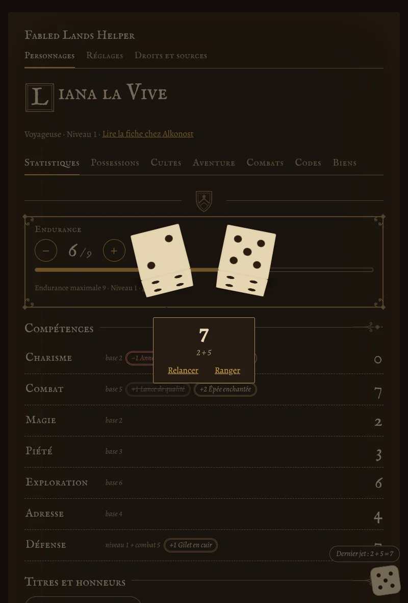
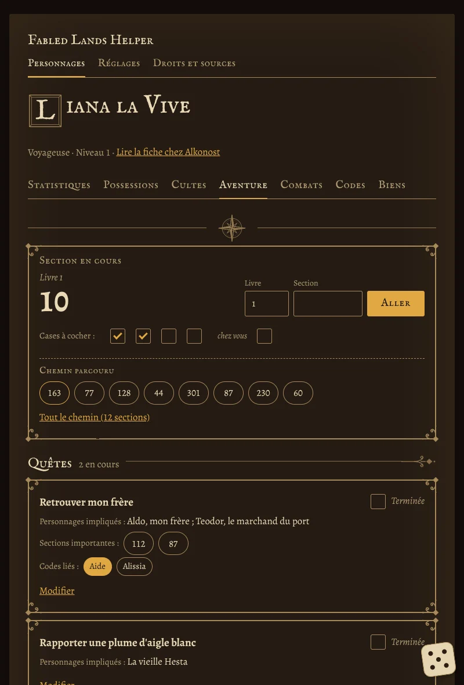
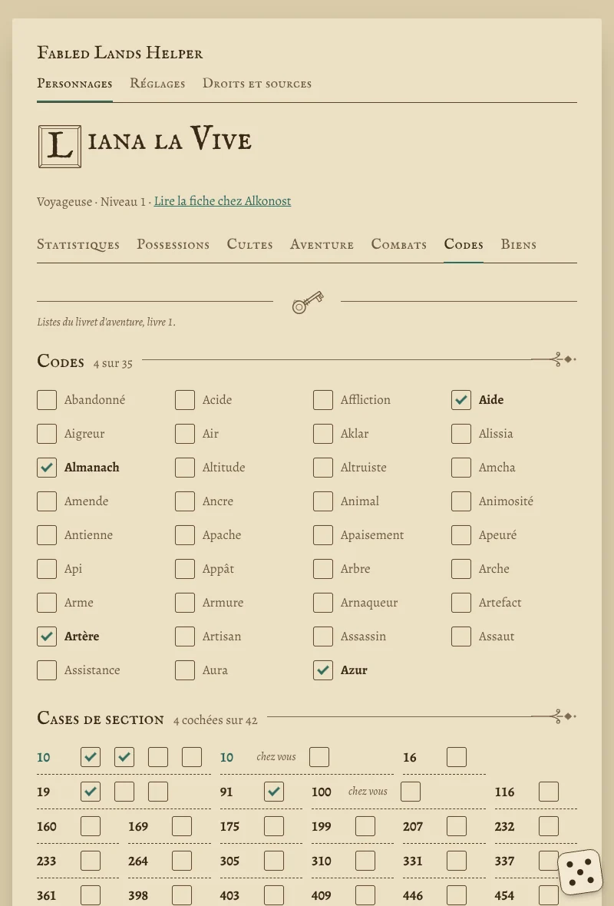
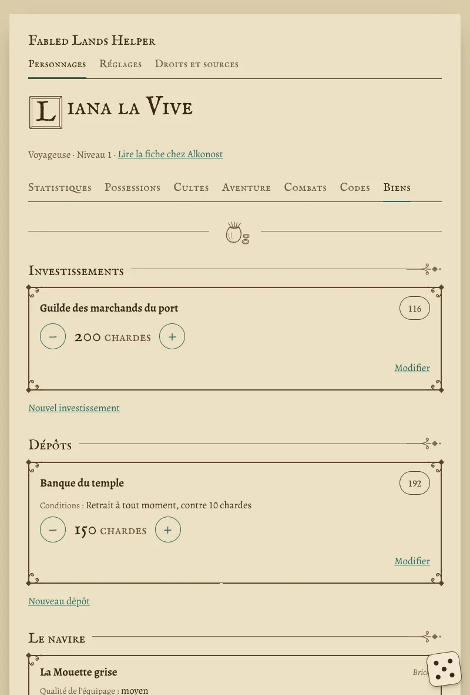
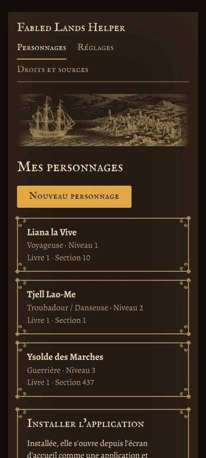
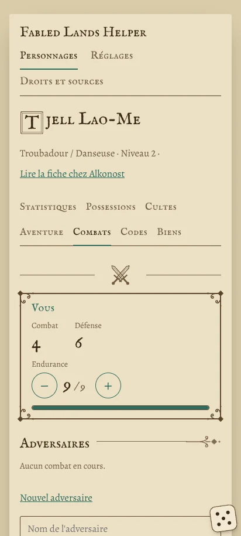

# Fabled Lands Helper

**Le carnet de bord de vos aventures dans *Fabled Lands*, sur tablette et téléphone.**
Feuille d'aventure, dés, journal, codes et biens : tout ce que vous noteriez au crayon, dans une application qui
fonctionne hors ligne et garde vos personnages sur votre appareil. Elle accompagne le livre papier, elle ne le remplace
pas.

**👉 Ouvrir l'application : <https://mirabellebenou.github.io/Fabled-Lands-Helper-App/>**

  

*Outil de fan, gratuit et non officiel, pour le tome 1 dans son édition française. — An English summary is
[at the end](#in-english).*

---

## Sommaire

- [Ce que fait l'application](#ce-que-fait-lapplication)
- [Ce qu'elle ne fait pas](#ce-quelle-ne-fait-pas)
- [L'installer sur sa tablette ou son téléphone](#linstaller-sur-sa-tablette-ou-son-téléphone)
- [Vos personnages et vos données](#vos-personnages-et-vos-données)
- [Pour les curieux : sous le capot](#pour-les-curieux--sous-le-capot)
- [Droits, sources et crédits](#droits-sources-et-crédits)
- [Licence](#licence)
- [In English](#in-english)

---

## Ce que fait l'application

### Une feuille d'aventure qui tient les comptes

Créez votre personnage à partir de l'un des **neuf pré-tirés** des livres 1 et 2 (les six d'origine et les trois créés
pour l'édition française), ou en **saisie libre**. La fiche reprend les rubriques du livret d'aventure : Endurance,
les six compétences, Défense, titres et honneurs, cultes et bénédictions, chardes, possessions…

Les **totaux se calculent seuls** : un objet porte son bonus (« +1 Lance de qualité », « −1 Cicatrice au visage »), et
seul le meilleur bonus d'objet compte pour chaque compétence. La Défense suit le niveau, le Combat et l'armure.

  
  

### Des dés qui roulent

Un bouton en forme de dé, toujours à portée de doigt sur la fiche : un ou deux dés en relief roulent sur la page et
restent posés avec leur total. Le dernier jet reste écrit, au cas où vous l'auriez oublié en tournant la page du
livre.

  

### Le journal de la partie

- **Aventure** : la section en cours, le **chemin parcouru** (un toucher sur une section y ramène), les **quêtes**
  calquées sur le livret (personnages, sections importantes, codes liés) et vos **notes**.
- **Combats** : vos adversaires, saisis librement, avec leur Endurance à côté de la vôtre.
- **Codes** : les 35 codes du livre 1 à cocher, et les **cases de section** — celles que le livre vous demande de
  cocher apparaissent aussi sous la section en cours.

  
  

### Les biens

Investissements, dépôts à la banque ou au temple, votre **navire** et sa cargaison, et les possessions que vous laissez
dans une maison ou un coffre, rangées par lieu.

  

### Au jour comme à la chandelle

Deux ambiances : **Jour** (vélin et encre sépia) et **Chandelle** (pour jouer le soir sans s'éblouir), ou celle de
votre appareil. L'application parle **français** et **anglais**, et s'adapte à la tablette comme au téléphone.

  
  

---

## Ce qu'elle ne fait pas

- **Elle ne remplace pas le livre** : aucun texte de section, aucune carte, aucune illustration des livres. Il vous
  faut le livre pour jouer.
- **Elle ne joue pas à votre place** : elle lance les dés et tient les totaux de la feuille, mais c'est vous qui lisez
  le résultat, résolvez le jet ou le combat et reportez ce que le livre vous dit.
- **Elle n'envoie rien sur Internet** : ni compte, ni serveur, ni publicité, ni mesure d'audience.

---

## L'installer sur sa tablette ou son téléphone

L'application s'ouvre dans le navigateur, mais elle est faite pour être **installée** : elle a alors son icône sur
l'écran d'accueil, s'ouvre en plein écran et **fonctionne sans réseau**.

| Appareil | Comment faire |
|---|---|
| **Android, Chrome** | Menu ⋮ du navigateur › **Installer l'application** (ou « Ajouter à l'écran d'accueil »). |
| **Android, Brave, Samsung Internet…** | Menu du navigateur › **Ajouter à l'écran d'accueil**. |
| **iPhone, iPad (Safari)** | Bouton **Partager** › **Sur l'écran d'accueil**. |

L'écran d'accueil de l'application rappelle ces gestes selon votre navigateur.

> **L'icône n'apparaît pas ?** Vérifiez dans les paramètres de l'appareil que votre navigateur a l'autorisation de
> créer des raccourcis sur l'écran d'accueil, puis recommencez.

**Les mises à jour** arrivent d'elles-mêmes : quand une nouvelle version est prête, un bandeau propose de
**Recharger**. Vous pouvez aussi **Vérifier les mises à jour** depuis **Réglages › Application**.

---

## Vos personnages et vos données

Vos personnages **restent sur votre appareil**, dans le stockage du navigateur. Rien ne part sur Internet.

Pour les mettre à l'abri ou les retrouver sur un autre appareil, passez par **Réglages › Sauvegarde** :

- **Exporter mes personnages** les enregistre tous dans un fichier ;
- **Partager mes personnages** envoie ce fichier (`.flh.txt`) au menu de partage de l'appareil : vers Google Drive,
  kDrive, un courriel… ;
- **Importer un fichier** relit une sauvegarde, d'où qu'elle vienne.

> **Un conseil** : exportez de temps en temps. Effacer les données du navigateur efface aussi vos personnages.

Une sauvegarde faite avec une version ancienne de l'application se relit toujours avec les suivantes.

---

## Pour les curieux : sous le capot

- **HTML, CSS et JavaScript**, sans framework ni étape de construction : les fichiers du dépôt sont ceux que sert le
  site.
- **Application web progressive** : un service worker garde tous les fichiers pour le hors-ligne ; aucune requête
  externe, polices comprises.
- **Les données** vivent dans IndexedDB ; la sauvegarde est un fichier JSON à numéro de schéma, avec sa migration
  d'une version à l'autre.
- **Les règles de la feuille** sont des fonctions pures, testées avec `node --test` (`tests/`).
- **Le hasard des dés** vient de `crypto.getRandomValues`.
- **Les ornements, la gravure et les vignettes** sont dessinés pour l'application et teints par l'ambiance.

| Dossier | Contenu |
|---|---|
| `index.html`, `sw.js`, `manifest.webmanifest` | la page, le service worker, le manifeste |
| `js/` | les écrans, les règles, les dés, la sauvegarde |
| `css/` | la feuille de style (ambiances Jour et Chandelle) |
| `i18n/` | les textes, en français et en anglais |
| `fonts/`, `icons/`, `ornements/` | les polices, les icônes, les ornements et illustrations |
| `tests/` | les tests du moteur |

**L'essayer chez soi** : les modules JavaScript ne s'ouvrent pas depuis un fichier local ; servez le dossier par un
petit serveur web, par exemple `python3 -m http.server`, puis ouvrez `http://localhost:8000/`. Les tests se lancent
avec `node --test tests/` (Node 22).

L'historique des versions est au [`CHANGELOG.md`](CHANGELOG.md).

---

## Droits, sources et crédits

- ***Fabled Lands*** est une série de livres-jeux de **Dave Morris et Jamie Thomson**. L'édition française est
  publiée par **[Alkonost](https://alkonost-editions.com/)**. Fabled Lands Helper est un **outil de fan, gratuit et
  non officiel**, sans lien avec les auteurs ni l'éditeur.
- Les **libellés de la feuille d'aventure**, la **liste des codes** et celle des **cases de section** suivent le
  livret d'aventure de l'édition française, en téléchargement libre sur le site d'Alkonost.
- Les **personnages pré-tirés** reprennent les chiffres et les possessions de départ des fiches publiées par Alkonost
  pour les livres 1 et 2 ; leur portrait et leur histoire sont sur la page de l'éditeur, à laquelle l'application
  renvoie.
- Tous les droits sur ces contenus restent à leurs auteurs et à l'éditeur.
- **Polices** : IM Fell English SC (Igino Marini) et Alegreya (Huerta Tipográfica), sous SIL Open Font License 1.1 —
  leurs licences sont dans `fonts/`.

L'application reprend ces mentions dans sa page **Droits et sources**.

---

## Licence

Le code de Fabled Lands Helper est un **logiciel libre**, sous licence
**[GNU Affero General Public License 3.0 ou toute version ultérieure](LICENSE)** (AGPL-3.0-or-later).

En clair : chacun peut lire ce code, le reprendre, le modifier et le redistribuer, **à condition que sa version reste
libre**, sous la même licence, **garde les mentions d'auteur**, et que son code source soit proposé à ceux qui
l'utilisent — y compris quand elle est servie en ligne.

La licence couvre **le code seulement** : ni les listes du livret, ni les personnages pré-tirés (dont les droits
restent à leurs auteurs et à l'éditeur), ni les polices (qui gardent leur licence OFL).

Copyright © 2026 MirabelleBenou.

---

## In English

**Fabled Lands Helper** is a companion app for playing the *Fabled Lands* gamebooks (book 1, French edition) on a
tablet or phone: adventure sheet with automatic totals and item bonuses, rolling 3D dice, adventure log (current
section, path taken, quests, notes), combats, codewords and tick-box sections, and possessions (investments, deposits,
ship and cargo). It speaks **French and English**, has a **day** and a **candlelight** theme, works **offline** once
installed, and keeps your characters **on your device** — export, import or share a save file to move them.

It accompanies the printed book and does not replace it: no section text, maps or illustrations from the books. It is
a **free, unofficial fan tool**. *Fabled Lands* is a series by Dave Morris and Jamie Thomson; the French edition is
published by Alkonost.

**Open the app: <https://mirabellebenou.github.io/Fabled-Lands-Helper-App/>** — then use your browser's *Install app*
or *Add to Home screen*.

The code is free software under the **[GNU AGPL 3.0 or later](LICENSE)**; the booklet lists, the pre-generated
characters and the typefaces keep their own rights and licences.
